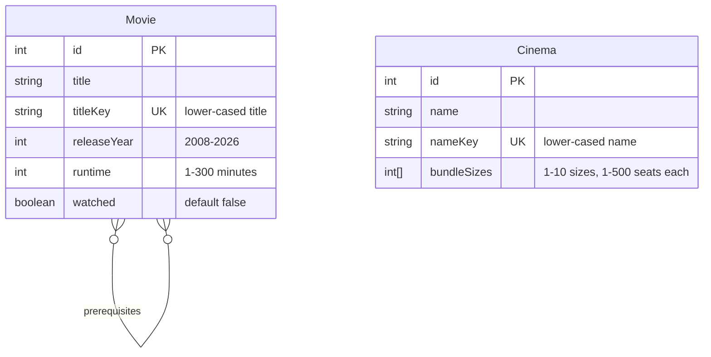

# Doomsday Ready

Plan your MCU rewatch before *Avengers: Doomsday* and check opening-night seat bundles.

- **Rewatch Order**: pick a movie, see everything to watch first (in order), watched ticks, progress and remaining time.
- **Movies**: add, edit and delete movies, set prerequisites, tick watched.
- **Cinemas**: add cinemas with bundle sizes, then check if a group size fits exactly.

**Stack:** TypeScript, Node, Express, Zod, PostgreSQL, Prisma, React, Vite, React Router, TanStack Query, react-hook-form, Tailwind, shadcn/ui, Vitest, Docker Compose.

## Run it

**Docker (one command):**
```bash
docker compose up --build
```
Open http://localhost:8080. The API runs the database migrations on start.

**Locally** (needs Node 22+ and a Postgres database):
```bash
cp .env.example .env            # then adjust DATABASE_URL if needed
npm install
npm run migrate:deploy -w @doomsday/api
npm run dev                     # web on :5173, API on :3001
```

**Tests:** `npm test`. The algorithm tests always run. The API tests (`apps/api/src/api.test.ts`) need a Postgres with the migrations applied and `DATABASE_URL` set; they wipe the Movie and Cinema tables, and are skipped otherwise.

## Structure
```
apps/api          Express + Prisma. routes/, algorithms/ (hand-written), middleware/, prisma/
apps/web          React app. pages/, components/, lib/ (API client and query hooks)
packages/shared   Zod schemas, constants and types used by both apps
```

## Data model

A movie can have many prerequisites and be a prerequisite of many movies (a join table, `_Prerequisites`). Cinemas are separate.

## API (under `/api`)
| Method and path | Purpose |
|---|---|
| `POST /movies`, `GET /movies` | Create, list |
| `PATCH /movies/:id` | Update fields, `watched`, `prerequisiteIds` (replaces the list) |
| `DELETE /movies/:id` | Delete (409 `MOVIE_IS_PREREQUISITE` if others depend on it) |
| `GET /movies/:id/rewatch-order` | Ordered prerequisites, `watchedCount`, `totalCount`, `remainingRuntime` |
| `POST /cinemas`, `GET /cinemas`, `DELETE /cinemas/:id` | Create, list, delete |
| `GET /cinemas/:id/booking?groupSize=6` | Fewest bundles, or `{ possible: false }` (still HTTP 200) |

Errors are `{ code, message }`: `VALIDATION_ERROR` (400), `NOT_FOUND` (404), and 409 for `CIRCULAR_DEPENDENCY`, `MOVIE_IS_PREREQUISITE`, `DUPLICATE_TITLE`, `DUPLICATE_CINEMA_NAME`.

## The algorithms (no libraries)
- **Loop check** (`algorithms/cycle.ts`): from each new prerequisite, walk its own prerequisites. If the walk reaches the movie being edited, there would be a loop. It runs inside a database transaction with an advisory lock, so two simultaneous edits cannot together create a loop. A newly created movie cannot be in a loop (nothing depends on it yet), so create does not run it.
- **Rewatch order** (`algorithms/rewatchOrder.ts`): depth-first walk from the target; a movie is added after all its prerequisites, so every movie comes after its prerequisites, each appears once, and the target is left out.
- **Bundles** (`algorithms/bundles.ts`): dynamic programming over seat counts 0 to the group size, tracking the fewest bundles and the last bundle used, then tracing back to count each size.

## Assumptions
- The first MCU film is *Iron Man* (2008), so release years run 2008-2026. It is one constant in `packages/shared`.
- No seed data; start with an empty database.
- Titles and cinema names are unique ignoring case and surrounding spaces.
- A movie that others list as a prerequisite cannot be deleted; remove it from their lists first.
- `POST /movies` and `POST /cinemas` create one item at a time.
- Bundle sizes are added one at a time in the UI and stored sorted.

## How AI was used
Claude Code (Anthropic) was used as a coding assistant: planning the design, scaffolding the monorepo, writing the code, the tests and this README. I directed the features, stack and decisions, and reviewed the output.
